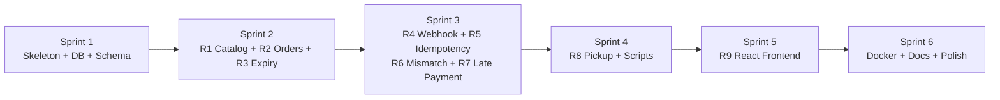
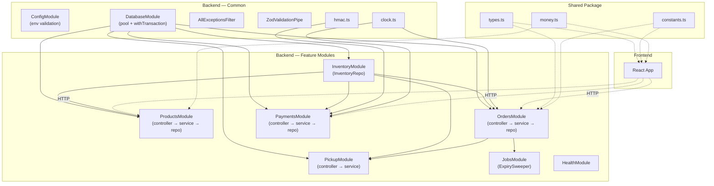
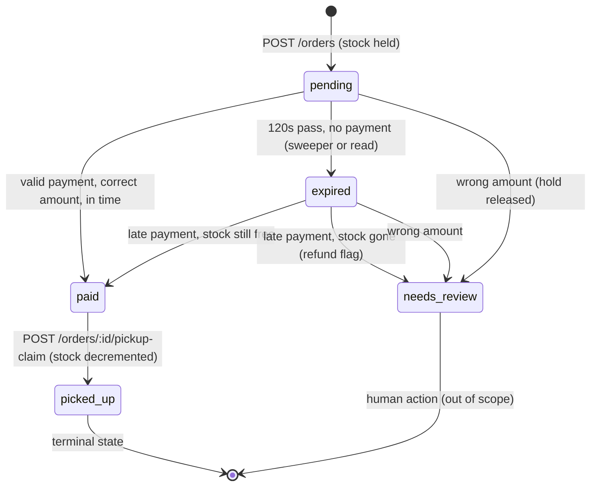
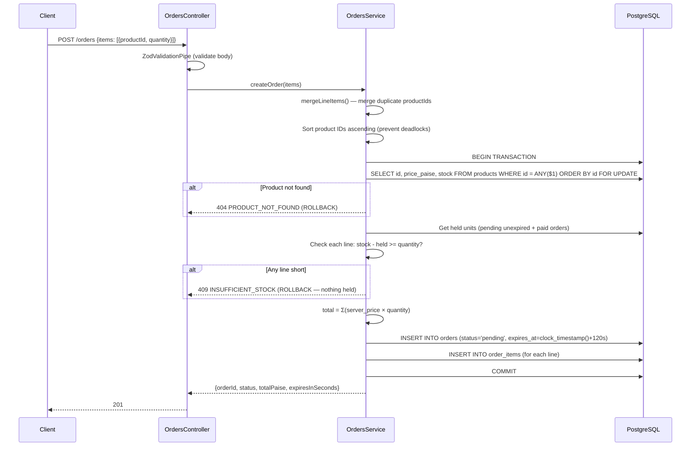
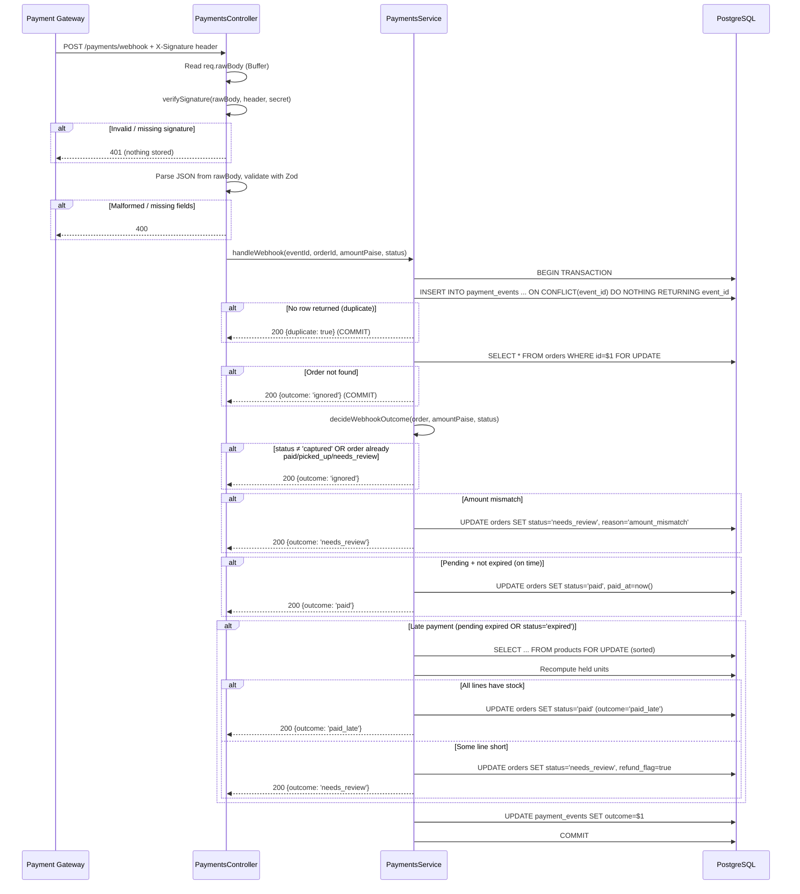
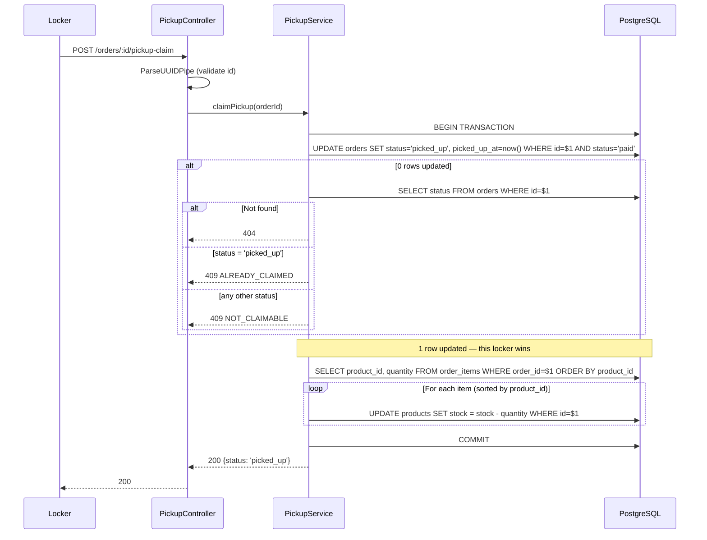
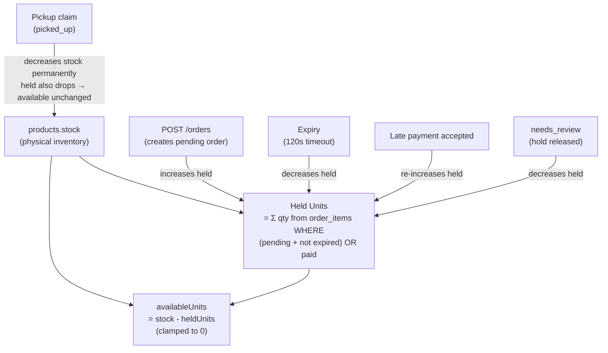
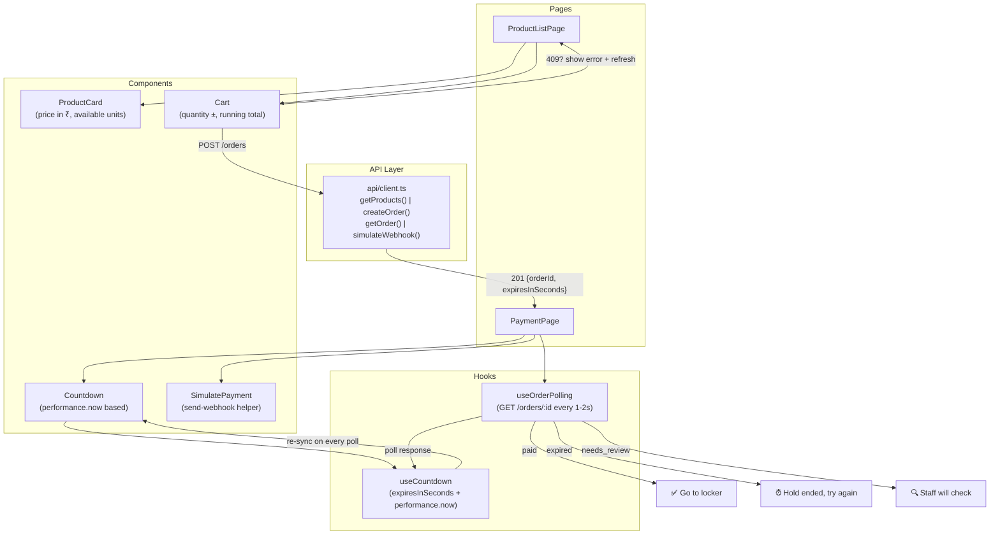
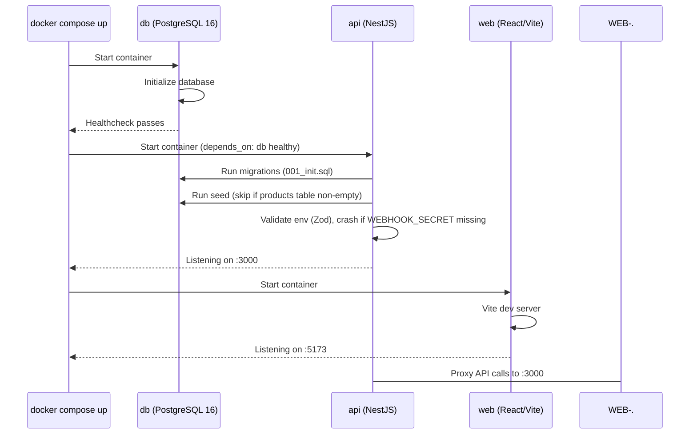

# Pickup Counter — Execution Flow & Architecture

> Build order, data flow, module dependencies, and request lifecycles.

---

## 1. Build Order (Sprint Sequence)

The build follows the dependency chain — each sprint only uses modules from previous sprints.



---

### Sprint 1 — Skeleton + Database + Schema
**Tasks:** T0.1–T0.6, T1.1–T1.15

```
File creation order:
─────────────────────────────────────────────
1. shared/package.json
2. shared/src/types.ts         ← OrderStatus, Product, OrderItem, WebhookPayload types
3. shared/src/constants.ts     ← HOLD_SECONDS = 120
4. shared/src/money.ts         ← toPaise(), formatRupees()
5. root package.json           ← workspaces: [backend, frontend, shared]
6. .env.example                ← DATABASE_URL, WEBHOOK_SECRET, HOLD_SECONDS
7. backend/package.json
8. backend/tsconfig.json
9. backend/src/main.ts
10. backend/src/bootstrap.ts    ← createApp({rawBody:true}), configureApp()
11. backend/src/app.module.ts
12. backend/src/config/env.schema.ts
13. backend/src/config/config.module.ts
14. backend/src/common/errors/app-error.ts
15. backend/src/common/errors/all-exceptions.filter.ts
16. backend/src/common/pipes/zod-validation.pipe.ts
17. backend/src/common/database/database.module.ts   ← Global
18. backend/src/common/database/database.service.ts  ← pool + withTransaction(fn)
19. backend/src/common/database/migrate.ts
20. backend/src/common/crypto/hmac.ts                ← verifySignature()
21. backend/src/common/time/clock.ts                 ← secondsLeft()
22. backend/migrations/001_init.sql                  ← Full schema
```

**Commit:** `chore: NestJS skeleton, database layer, shared types, and migration (T0, T1)`

---

### Sprint 2 — R1 Catalog + R2 Orders + R3 Expiry
**Tasks:** T2.1–T2.9, T3.1–T3.11, T4.1–T4.5

```
File creation order:
─────────────────────────────────────────────
1. backend/src/modules/inventory/inventory.module.ts
2. backend/src/modules/inventory/inventory.repo.ts   ← getHeldUnits(), decrementStock()
3. backend/src/modules/products/products.module.ts
4. backend/src/modules/products/products.repo.ts
5. backend/src/modules/products/products.service.ts  ← computeAvailable() used here
6. backend/src/modules/products/products.controller.ts
7. backend/scripts/seed.ts                           ← 5 products, skip if non-empty
8. backend/src/modules/orders/orders.schema.ts       ← Zod: items[{productId, quantity}]
9. backend/src/modules/orders/orders.repo.ts
10. backend/src/modules/orders/orders.service.ts      ← createOrder(), mergeLineItems()
11. backend/src/modules/orders/orders.controller.ts
12. backend/src/modules/orders/orders.module.ts
13. backend/src/modules/jobs/expiry-sweeper.service.ts
14. backend/src/modules/jobs/jobs.module.ts
15. backend/tests/helpers/db.ts                       ← truncate, forceExpire
16. backend/tests/helpers/factories.ts                ← createTestOrder, etc.
17. backend/tests/helpers/app.ts                      ← test app with rawBody
18. backend/tests/integration/products.spec.ts        ← A1–A6
19. backend/tests/integration/orders.spec.ts          ← B1–B16
20. backend/tests/concurrency/orders.spec.ts          ← B17–B20
21. backend/tests/integration/expiry.spec.ts          ← C1–C5
```

**Commits:**
- `feat(R1): catalog and stock with available units (T2)`
- `feat(R2): place order with transactional stock hold (T3)`
- `feat(R3): expire-on-read and background sweeper (T4)`

---

### Sprint 3 — R4 Webhook + R5 Idempotency + R6 Mismatch + R7 Late Payment
**Tasks:** T5.1–T5.5, T6.1–T6.3, T7.1–T7.6, T8.1–T8.4

```
File creation order:
─────────────────────────────────────────────
1. backend/src/modules/payments/payments.schema.ts    ← Zod: eventId/event_id, orderId/order_id
2. backend/src/modules/payments/payments.repo.ts      ← insertEvent (ON CONFLICT DO NOTHING)
3. backend/src/modules/payments/payments.service.ts   ← handleWebhook() full orchestration
4. backend/src/modules/payments/payments.controller.ts ← raw body, signature verify, @HttpCode(200)
5. backend/src/modules/payments/payments.module.ts
6. backend/tests/helpers/webhook.ts                   ← signBody(), sendWebhook()
7. backend/tests/unit/hmac.spec.ts                    ← G2
8. backend/tests/unit/webhook-outcome.spec.ts         ← G1
9. backend/tests/integration/webhook.spec.ts          ← D1–D21
10. backend/tests/unit/transitions.spec.ts             ← G6
```

**Commits:**
- `feat(R4): webhook signature verification with raw body HMAC-SHA256 (T5)`
- `feat(R5): idempotent payment events via primary key dedup (T6)`
- `feat(R6): amount mismatch detection → needs_review (T7)`
- `feat(R7): late payment — accept if stock free, review if gone (T8)`

---

### Sprint 4 — R8 Pickup + Scripts + Remaining Tests
**Tasks:** T9.1–T9.7, T11.1–T11.3, T12.4–T12.5, T13.1–T13.7, T15.1–T15.4

```
File creation order:
─────────────────────────────────────────────
1. backend/src/modules/pickup/pickup.service.ts
2. backend/src/modules/pickup/pickup.controller.ts    ← @HttpCode(200)
3. backend/src/modules/pickup/pickup.module.ts
4. backend/scripts/send-webhook.ts                    ← CLI with flags
5. backend/tests/integration/pickup.spec.ts           ← E1–E8
6. backend/tests/concurrency/pickup.spec.ts           ← E9–E11
7. backend/tests/concurrency/required.spec.ts         ← B17, D2/D3, E9 (the 3 protected)
8. backend/tests/integration/journeys.spec.ts         ← F1–F4
9. backend/tests/unit/availability.spec.ts            ← G3, G4, G5, G7
```

**Commits:**
- `feat(R8): atomic pickup claim with single-winner guarantee (T9)`
- `feat(R10): required concurrency tests — B17, D2/D3, E9 (T11)`
- `test: unit tests for pure domain functions G1–G7 (T13)`
- `test: full journey tests F1–F4 (T15)`

---

### Sprint 5 — R9 React Frontend
**Tasks:** T10.1–T10.11, T14.1–T14.5

```
File creation order:
─────────────────────────────────────────────
1. frontend/package.json + vite.config.ts
2. frontend/src/api/client.ts                ← axios/fetch wrapper
3. frontend/src/api/products.ts
4. frontend/src/api/orders.ts
5. frontend/src/hooks/useCountdown.ts        ← performance.now() based
6. frontend/src/hooks/useOrderPolling.ts     ← poll every 1–2s
7. frontend/src/components/ProductCard.tsx
8. frontend/src/components/Cart.tsx
9. frontend/src/components/Countdown.tsx
10. frontend/src/pages/ProductListPage.tsx
11. frontend/src/pages/PaymentPage.tsx
12. frontend/src/App.tsx                      ← routing
13. frontend/src/tests/useCountdown.test.ts   ← H1–H3
14. frontend/src/tests/PaymentPage.test.ts    ← H4–H5
```

**Commit:** `feat(R9): React customer screen with countdown and polling (T10)`

---

### Sprint 6 — Docker + Quality + Documentation
**Tasks:** T12.1–T12.3, T12.6, T16.1–T16.5, T17.1–T17.5

```
File creation order:
─────────────────────────────────────────────
1. backend/src/modules/health/health.controller.ts
2. backend/src/modules/health/health.module.ts
3. backend/Dockerfile
4. frontend/Dockerfile
5. docker-compose.yml
6. README.md                                  ← full docs
7. AI_NOTES.md
```

**Commits:**
- `feat(R11): Docker Compose, Dockerfiles, send-webhook script (T12)`
- `chore(Q): health endpoint, linting, graceful shutdown, logging (T16)`
- `docs(R12, R13): README with decisions and trade-offs, AI_NOTES (T17)`

---

## 2. Architecture — Module Dependency Graph



> **Key rule (Q6):** `InventoryModule` exports `InventoryRepo` and is imported by Orders, Payments, and Pickup. Stock logic exists **once**.

---

## 3. Order State Machine



---

## 4. Request Flows

### 4.1 — `POST /orders` (Create Order)



---

### 4.2 — `POST /payments/webhook` (Handle Payment)



---

### 4.3 — `POST /orders/:id/pickup-claim` (Claim Pickup)



---

## 5. Stock & Availability Flow



> **Critical insight:** Pickup reduces `stock` permanently but also removes the order from the "held" pool (status changes from `paid` to `picked_up`). So `availableUnits` stays the same after pickup — the math is self-balancing.

---

## 6. Frontend Component Flow



**Countdown logic (never uses `Date.now()`):**
```
receivedAt = performance.now()           // when server response arrives
remaining = expiresInSeconds - (performance.now() - receivedAt) / 1000
// Re-sync: on each poll, reset receivedAt and expiresInSeconds
// At 0: do NOT declare expiry. Wait for server status.
```

---

## 7. Docker Compose Startup Sequence



---

## 8. Git Commit Plan (in order)

| # | Commit Message | Tasks | Req |
|---|---------------|-------|-----|
| 1 | `chore: NestJS skeleton, DB layer, shared types, migration` | T0.1–T0.6, T1.1–T1.15 | — |
| 2 | `feat(R1): catalog with seed and available units` | T2.1–T2.9 | R1 |
| 3 | `feat(R2): place order with transactional stock hold` | T3.1–T3.11 | R2 |
| 4 | `feat(R3): expire-on-read and background sweeper` | T4.1–T4.5 | R3 |
| 5 | `feat(R4): webhook HMAC-SHA256 signature on raw body` | T5.1–T5.5 | R4 |
| 6 | `feat(R5): idempotent payment events via PK dedup` | T6.1–T6.3 | R5 |
| 7 | `feat(R6): amount mismatch → needs_review` | T7.1–T7.6 | R6 |
| 8 | `feat(R7): late payment with stock-aware acceptance` | T8.1–T8.4 | R7 |
| 9 | `feat(R8): atomic pickup claim, single-winner` | T9.1–T9.7 | R8 |
| 10 | `feat(R10): required concurrency tests B17, D2/D3, E9` | T11.1–T11.3 | R10 |
| 11 | `test: unit tests for pure domain functions G1–G7` | T13.1–T13.7 | R10 |
| 12 | `test: full journey tests F1–F4` | T15.1–T15.4 | R10 |
| 13 | `feat(R9): React customer screen with countdown` | T10.1–T10.11 | R9 |
| 14 | `test: frontend tests H1–H5` | T14.1–T14.5 | R9 |
| 15 | `feat(R11): Docker Compose, Dockerfiles, send-webhook` | T12.1–T12.6 | R11 |
| 16 | `chore(Q): health, linting, graceful shutdown, logging` | T16.1–T16.5 | Q |
| 17 | `docs(R12,R13): README, decisions, AI_NOTES` | T17.1–T17.5 | R12, R13 |
